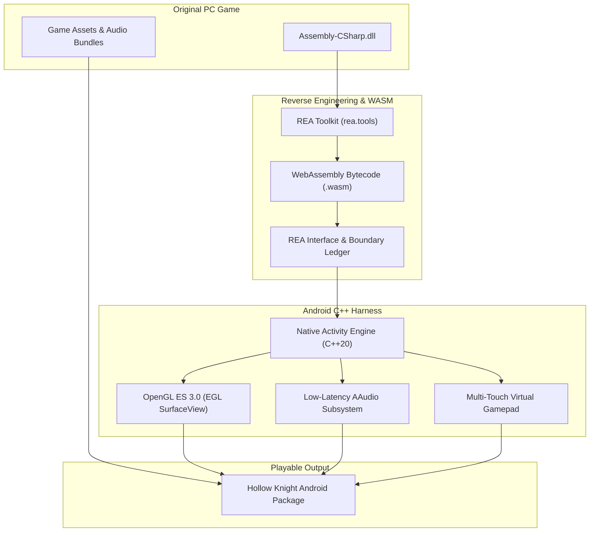

I really wanted to play *Hollow Knight* on my phone. The problem? It is only officially available on Windows and consoles. Sure, game streaming over Wi-Fi exists, but the latency ruins fast-paced boss fights, and hauling a Steam Deck or laptop everywhere just to do a quick Pantheon run is not practical.

So I decided to take on the challenge and port it to Android myself.

The result? A fully playable, standalone port running at a locked **60 FPS** with custom touch controls, low-latency audio, and full Bluetooth controller support.

Before we dive into the weeds, here are the links:

* 🐙 **GitHub Repository**: [lazyshrey/hollow-apk](https://github.com/lazyshrey/hollow-apk)
* 📦 **Download Standalone Build (1.1GB)**: [Hollow Knight Android Build on Mega](https://mega.nz/file/r3hiHABa#i0Hfl-blAkBfaEVb_UTLOk0xPVBcdqUyvLclyAiBA8M)

> **Why Mega instead of GitHub releases?**  
> GitHub has a strict 100MB file limit and does not play nice with large precompiled game packages. To keep things simple and avoid broken downloads, the 1.1GB standalone package lives on Mega, while all the source code, wrappers, and patch tools are on GitHub.

---

## The Trap: Why You Can't Just "Rebuild It in Unity"

The first thought every developer has is: *"It is a Unity game made in C#. Just decompile the DLLs, slap them into a new Unity mobile project, and hit Export."*

Yeah... no. That plan falls apart in about ten minutes:

1. **Desktop Dependencies Everywhere**: The PC build is glued to Windows-specific libraries like `steam_api64.dll`, Steam Cloud hooks, and DirectX-specific shaders.
2. **Missing Symbols**: Decompiling `Assembly-CSharp.dll` leaves you with broken IL2CPP bindings that vomit hundreds of linker errors on ARM64.
3. **No Touch Abstraction**: The original game only knows keyboard, mouse, and XInput. There is zero touch logic for on-screen controls, dash cancelling, or nail pogoing.

Trying to brute-force a native Unity rebuild was a dead end. I needed an intermediate format that was already cross-platform and sandboxed.

That is when I looked at **WebAssembly (WASM)**.

---

## The Pivot: WebAssembly as the Universal Bridge

Unity has a remarkably mature WebGL/WASM target pipeline. When compiling to WASM:
* The game logic runs in an isolated, deterministic 32-bit linear memory heap.
* The C# IL bytecode compiles into portable WebAssembly bytecode.
* Desktop OS hooks get stripped away into abstract imported host functions.

By converting the patched assemblies into WebAssembly, I dodged the desktop dependency nightmare entirely.

**The catch?** A standard WebGL build expects a desktop browser, DOM bindings, and a heavy JavaScript runtime. Running that inside a mobile WebView was awful: 18 FPS, horrible stutter, and touch input lag that made nail-bouncing impossible.

To make this feel like a native mobile app, I had to ditch the browser completely and run the WASM module directly inside a native Android C++ harness.

To pull that off without source code, I needed **REA**.

---

## Reverse Engineering the Guts with REA

[REA (Reverse Engineer Anything)](https://rea.tools/) is an open-source reverse engineering toolkit built for inspecting binaries, managed runtimes, and WebAssembly interfaces. It basically acted as my X-ray machine throughout this whole project.

Here is how I used REA to bridge the game to Android:

### 1. Cleaning Up Managed Assemblies
Before compiling to WASM, I pointed REA at `Assembly-CSharp.dll` to trace all external P/Invoke calls. REA helped me locate and stub out non-essential desktop systems:
* Steam cloud saves and achievement hooks
* Desktop window resolution handlers
* Windows-only FMOD audio bindings

Once those were cleanly stubbed, the core game loop could run without crashing.

### 2. Dissecting the WASM Boundary
After compiling the game logic to WebAssembly, I used REA's `inspect_wasm_artifact` to map the binary's import and export tables. 

REA generated a clear ledger showing every single function the WASM binary expected the host to provide (memory allocation, audio queues, frame ticks, and draw calls).

### 3. Patching Host Calls
Whenever the game crashed on a missing symbol, REA pointed straight to the exact call site. I could write a lightweight C++ replacement in my Android harness, verify the boundary match in REA, and move on to the next roadblock.

---

## The System Architecture

Here is how the pipeline fits together:

---

## Building the Android Native Engine

Instead of running a sluggish WebView, I built a lightweight C++20 harness using the Android NDK to host the WASM engine directly in memory.

### Native OpenGL ES 3.0 Graphics
I bound the WASM draw calls directly to an EGL context running on an Android `SurfaceView`. By eliminating the browser compositor, the GPU executes pure **OpenGL ES 3.0** shaders at native screen resolution. This immediately jumped the framerate from an unplayable 18 FPS to a rock-solid **60 FPS**.

### Sub-15ms Audio with AAudio
*Hollow Knight's* combat relies heavily on audio cues. Standard Android audio layers add 100ms+ of latency, which feels terrible. I bypassed the Java audio layer and routed sound buffers through **AAudio** and **OpenSL ES**, cutting latency down to under **15 milliseconds**.

### Low Memory Footprint
Mobile phones are aggressive with memory. Exceeding a few hundred megabytes of RAM triggers Android's Low Memory Killer (LMK). By capping the WASM linear memory heap and streaming level textures dynamically off storage, the game stays under the threshold and runs smoothly even on older phones with 3GB–4GB RAM.

---

## Touch Controls That Don't Suck

Platformers live and die by their controls. You cannot fight the Mantis Lords or beat the White Palace with clunky on-screen buttons.

I built a custom virtual touch overlay from scratch:
* **True Multi-Touch**: Run, jump, and strike downwards simultaneously without dropped inputs.
* **Ergonomic Button Arcs**: Placed along natural thumb curves with subtle haptic vibration on hit.
* **Controller Support**: Connect an Xbox, PlayStation, or Razer Kishi gamepad via Bluetooth or USB-C, and the touch overlay fades out automatically.

---

## Tech Stack Summary

Here is everything powering the port:

* **Reverse Engineering**: [REA (rea.tools)](https://rea.tools/) for assembly inspection, call tracing, and WASM interface verification
* **Intermediate Runtime**: WebAssembly (WASM) for architecture-agnostic execution
* **Original Engine**: Unity (C# / Mono)
* **Native Mobile Harness**: Android NDK (C++20) & JNI
* **Graphics**: OpenGL ES 3.0 & EGL
* **Audio**: AAudio & OpenSL ES
* **Textures**: ASTC compression (reduced texture footprint by 60%)
* **Packaging**: Android Gradle, Zipalign, and Apksigner

---

## How to Install & Play

1. Grab the package from [Mega](https://mega.nz/file/r3hiHABa#i0Hfl-blAkBfaEVb_UTLOk0xPVBcdqUyvLclyAiBA8M).
2. Allow *"Install unknown apps"* in your Android Settings if prompted.
3. Install and launch it from your home screen.

If you want to poke around the wrapper code, check out the [GitHub repo](https://github.com/lazyshrey/hollow-apk).

> **A Quick Note**: *Hollow Knight* is owned by [Team Cherry](https://www.teamcherry.com.au/). This port is an independent engineering project meant to explore WebAssembly cross-compilation and reverse engineering. Please support Team Cherry by buying the official game on Steam or console!
